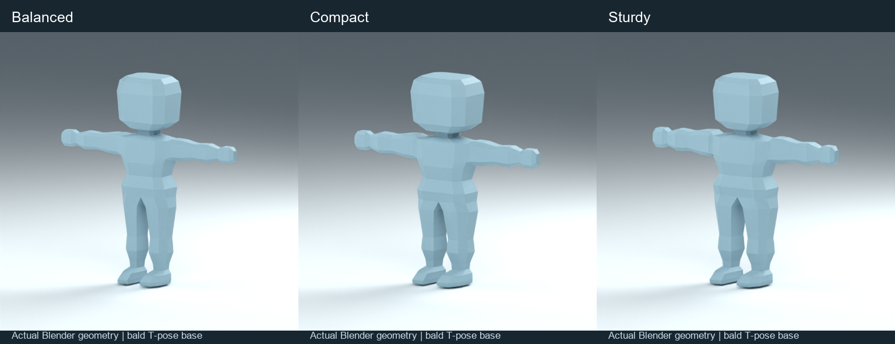
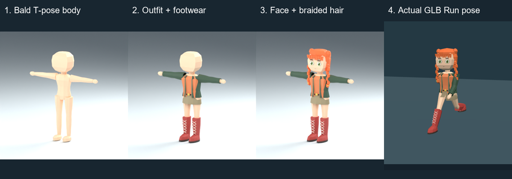

# Character Studio for Codex

Start stylized low-poly Blender characters with a reusable T-pose mannequin. Review its proportions and joints, then fit clothing, footwear, face, hair and motion for browser-game GLB delivery.

Character Studio is a community plugin with three Codex skills. It is inspired by Game Studio's design → implementation → asset pipeline → visual review workflow. It is independently authored and is not an official OpenAI or Blender Foundation plugin.



The new base family uses connected faceted geometry with a large head, short neck, broad torso and substantial limbs. Balanced is the starting preset; Compact and Sturdy offer different proportions. Reference images default to original interpretations in this house style, using Balanced for suitable humanoids unless instructed otherwise. The mannequin is the first phase: clothing, face, hair and gameplay motion still need fitting and review.




## Install

Install [Codex](https://developers.openai.com/codex/) and [Blender 4.5 LTS](https://www.blender.org/download/). Blender is a separate prerequisite; this repository does not include it. The bundled GLB inspector also needs Python 3. Browser effects need Three.js in your game project.

**Easiest: paste this into a Codex chat:**

> Install Character Studio from https://github.com/raising-heart/character-studio. Register its plugin marketplace, install character-studio@character-studio, and verify it is enabled. Locate my Blender executable or help me configure it.

**Or use the Codex CLI:**

```sh
codex plugin marketplace add raising-heart/character-studio --ref main
codex plugin add character-studio@character-studio
```

Start a new Codex chat after installation. If the skills are missing, restart the app. If your CLI supports marketplace registration but has no `plugin add` command, register the marketplace, then select **Character Studio — Community** in the app's Plugins Directory and install **Character Studio**.

For a pinned release, register the marketplace with `--ref v0.6.1` instead of `--ref main`.

The marketplace layout and GitHub registration follow [OpenAI's plugin packaging documentation](https://developers.openai.com/plugins/build/plugins). GitHub distribution is separate from listing in OpenAI's public Plugins Directory.

## Use it

Start with the base body:

> Use $character-base-body to build a Balanced mannequin in our own faceted low-poly style. Keep it bald and in T-pose. Inspect front, side, back and three-quarter views and test both shoulders, elbows, knees, hips and torso twist. Deliver the reusable .blend, GLB and joint-study previews before adding clothing.

Create a character:

> Use $character-studio to make a stylized low-poly adventurer in Blender: teal and warm yellow, a large readable head, 1.8 m tall, and a budget of 5,000 triangles. Deliver an editable .blend, a GLB, and front, side, back, and three-quarter renders. Add Idle and Walk if practical and verify the export.

Add effects:

> Use $character-effects to add a cyan hand aura and animation-timed sparks to my character. Make Blender previews and integrate separate Three.js effects with the GLB in my browser game.

Create an animal:

> Use $character-studio to make a stylized low-poly fox in Blender, with a readable tail and Idle, Walk, Run and Jump animations. Deliver the editable .blend, GLB, turnarounds and a runtime animation preview.

Be specific about your character's look, intended camera distance, triangle budget, required clips, and target game engine. These are workflows and starter scripts: custom character design still needs iteration and visual review.

### Interpret an image reference

Attach the reference in a Codex chat and ask:

> Use Character Studio to create a character from this reference.

By default, Codex interprets the reference in our Balanced low-poly house style, checks the plain T-pose body, then shows a simple body-and-outfit blockout for feedback before adding facial features or hair detail. You do not need to repeat the style/proportion choice. Ask for a different style, body build or faithful reconstruction to override it; say "finish without interactive reviews" to skip the feedback pause. Existing accepted assets and base-only, edit, animation or effects requests keep their scope.

The default humanoid foundation is [Character Base Body](plugins/character-studio/skills/character-base-body/SKILL.md), with one connected closed surface and an optional 16-bone rig. Its five study actions test joints; they are not gameplay clips. A faithful reconstruction brief can override the house-style interpretation. Robot-base remains available for mechanical designs; animals use their own rig. Unsupported forms need task-specific modelling. Difficulty is a subjective effort estimate, not a likeness score or success probability.

The legacy 0.5 dressed starter remains available for compatible existing assets, with jacket/tunic, boots, mesh face, hair, selective edits and Idle/Walk/Run/Jump/Roll. Its geometry and clothing do not directly fit the new base. New body proportions require coherent rig/weight/costume updates. See [base construction](plugins/character-studio/skills/character-base-body/references/base-body-construction.md), [legacy staged construction](plugins/character-studio/skills/character-studio/references/staged-construction.md) and [build paths](plugins/character-studio/skills/character-studio/references/reference-adaptation.md).

## Included workflows

| Skill | Capabilities |
| --- | --- |
| `$character-base-body` | Reusable connected T-pose mannequin, balanced/compact/sturdy proportions, plain turnarounds, rig/weight checks and five joint studies before character detail |
| `$character-studio` | Brief, silhouette and proportions, Blender modelling/materials, optional rigging and animation, GLB export, budget checks and visual review |
| `$character-effects` | Blender mesh-effect previews; Three.js sparks, fire/smoke, dust and magic bursts; bone-attached emitters, auras, simple fading trails, animation cues, bounded particle pools, reduced motion and cleanup |

The Blender robot starter includes a rigid segmented rig, looping **Idle/Walk/Run** and one-shot **Jump/Roll**. The quadruped starter supports **fox/dog/cat** silhouettes with four-leg/tail rigs and **Idle/Walk/Run/Jump**. It is a segmented reference, not an arbitrary animal generator. Birds, snakes, fish and other body plans need custom geometry, rigs and motion.

Jump has baked vertical lift and Roll has visual pivot/ground-clearance offsets. Game controls, collision handling and horizontal travel are separate runtime work. If physics controls jump height, remove the copied Jump clip's Root position track to avoid adding lift twice. See [rigging and runtime integration](plugins/character-studio/skills/character-studio/references/rigging.md) and [animal guidance](plugins/character-studio/skills/character-studio/references/animals.md).

The effects helper adds its collection to a copy of an existing rigged Blender scene and saves a new file. Ordinary work should copy/adapt starter scripts in your own project.


### Locate Blender

On Windows, the bundled `find_blender.ps1` checks an explicit executable, `BLENDER_EXECUTABLE`, PATH, standard install folders and a Character Studio portable runtime. You can also tell Codex your executable's absolute path. On macOS/Linux, use your installed Blender executable directly; the discovery helper is Windows-specific.

### Browser effects

Copy [three-character-effects.mjs](plugins/character-studio/skills/character-effects/assets/three-character-effects.mjs) into your game and supply its existing Three.js namespace. See [runtime integration](plugins/character-studio/skills/character-effects/references/runtime-effects.md) for anchors, offsets, animation cues and disposal.

Ship this runtime code/config alongside the character GLB. Blender particles, procedural shaders, compositor glow and fluid simulations do not automatically transfer as live GLB effects. Fire/smoke are stylized puffs; trails are simple lines. Advanced fluids, bloom, wide ribbons and organic/facial rigging require additional work.

## Updates and local development

The [workflow design](docs/staged-character-workflow-plan.md) records the staged implementation and future extensions.

For an installation tracking `main`, refresh the catalog and install the current plugin version:

```sh
codex plugin marketplace upgrade character-studio
codex plugin add character-studio@character-studio
```

Start a new chat afterward. A pinned tag stays on that release until you change its ref. If you already have the original `character-studio-local` installation, choose one source to enable so the duplicate skills do not compete; there is no need to reinstall your working copy just to share this repository.

To edit the source:

```sh
git clone https://github.com/raising-heart/character-studio.git
cd character-studio
codex plugin marketplace add .
codex plugin add character-studio@character-studio
```

This registers your checkout under the same community marketplace name. Edit `plugins/character-studio`, bump the plugin manifest version for a release, and reinstall. See [CONTRIBUTING.md](CONTRIBUTING.md).

## Validation

Version 0.6.1 changes instructions and metadata only. All three skills, package links/metadata, the security audit and installed resources were checked. The executable helpers and base preset are byte-identical to 0.6.0; its geometry/runtime validation remains applicable. This update does not implement automatic reference conversion or new fitting/motion tools.

Version 0.6.0 generated and reviewed all three base-body variants with Blender 4.5.14 LTS. Each has one connected closed body, 434 source vertices, 864 triangles and an optional 16-bone rig. Source topology checks report one component, zero nonmanifold edges/zero-area faces and Euler characteristic 2. Exported skin checks verify rest symmetry, normalised weights, level T-pose arms and observable shoulder/elbow/knee/hip/twist studies without severe edge collapse/stretch. All three GLBs have zero Khronos errors/warnings. Balanced was rendered in 24 actual GLB browser views plus mobile with no errors or external requests. Static output, invalid JSON settings, overwrite refusal and the fresh-process guard were exercised. The plain body and joint studies still require visual judgement; this validates a mannequin foundation, not a finished costume or production character.

Version 0.5.0 was checked with Blender 4.5.14 LTS and Three.js 0.186.1. The staged reference study has 3,950 triangles, six meshes, 16 bones and five clips; a second proportion/style variant has 3,094 triangles. Checks cover T-pose binding, both arm/leg chains, finite skinned vertices, ground clearance, clip endpoints, Jump lift, full Roll and one-shot holding. Browser tests cover 75 poses, desktop/mobile rendering and both one-shot completions. Checkpoint tests preserve unrelated geometry, a manual face edit and animation while actually changing the boots. Static output, invalid settings and overwrite/autoexec protections were exercised. Both final animated GLBs pass Khronos validation with zero errors or warnings.

The original robot/animal and effects pipelines retain their earlier validation; the robot/quadruped generators are unchanged, and the effects loader now explicitly disables embedded scripts. Earlier checks include:

- All three skills passed Codex's skill validator.
- Robot GLB: 1,016 triangles, 16 bones, Idle/Walk/Run/Jump/Roll; zero Khronos glTF Validator errors or warnings.
- Fox GLB: 1,184 triangles, 19 bones, Idle/Walk/Run/Jump; zero Khronos glTF Validator errors or warnings. Dog, cat and static-cat generation were also exercised.
- New animation checks covered finite skinned vertices, loop boundaries, faster Run cadence, Jump lift/landing, full Roll rotation, ground clearance and one-shot holding. Both GLBs were rendered in headless Edge at desktop/mobile sizes with zero console errors.
- The 0.3.1 gait regression checks both knees, leading ankles and foot pitch at 65 samples per side in Walk/Run. It rejects the 0.3.0 hyperextended gait and passes the corrected animation.
- The unchanged effects workflow was previously checked with Blender aura/sparks/fire/smoke renders, runtime lifecycle/cap/anchor/cue tests, and headless Edge rendering with reduced motion.

This validation covers the supplied starters, not arbitrary reconstruction. The humanoid face is static, hands are simple mittens, hair is rigid, and body attachment seams/analytic weights need visual review. Review every new character in its destination runtime. The Python GLB inspector is not a complete glTF validator.

## Security and dependencies

The shipped Blender helpers use local files and have no network client, telemetry, credentials, shell execution, install hooks or background service. The new builder uses a bounded JSON schema, refuses accidental overwrites and opens checkpoints with embedded scripts disabled. Optional image comparisons use Python with Pillow; it is not installed automatically. Model generation needs only Blender and bundled scripts. See [security review](plugins/character-studio/SECURITY.md) and [third-party notices](plugins/character-studio/THIRD_PARTY_NOTICES.md). Run `python tests/audit_plugin.py` to repeat static checks; these complement manual review and do not sandbox Blender.

## License and origin

[MIT](LICENSE). Keep the license and [attribution](plugins/character-studio/ATTRIBUTION.md) when sharing modifications. Game Studio is not required. This plugin has no bundled MCP server, API keys or paid-service dependency.
