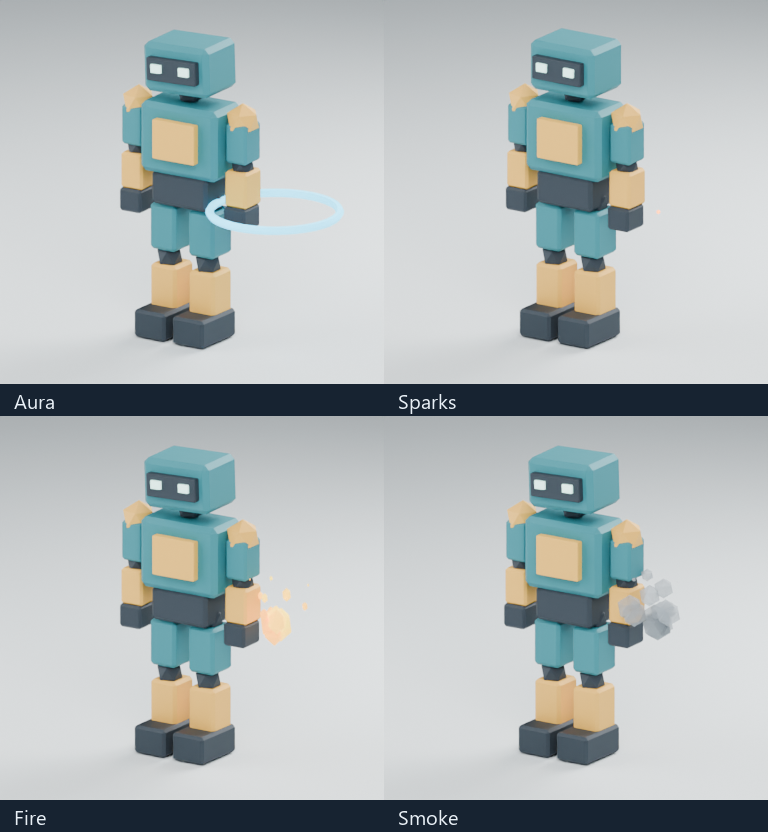
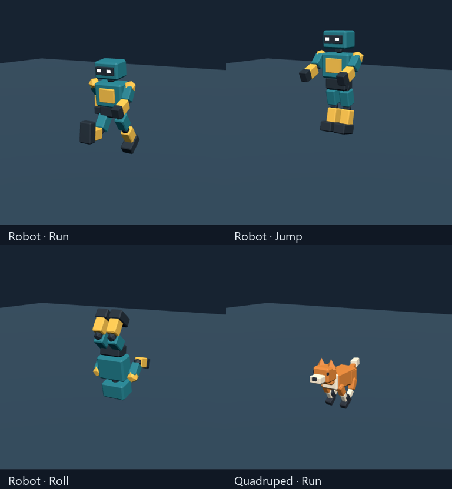

# Character Studio for Codex

Design stylized low-poly 3D characters and animals in Blender, add animation and effects, and prepare GLB assets for browser games.

Character Studio is a community plugin with two Codex skills. It is inspired by Game Studio's design → implementation → asset pipeline → visual review workflow. It is independently authored and is not an official OpenAI or Blender Foundation plugin.



## Install

Install [Codex](https://developers.openai.com/codex/) and [Blender 4.5 LTS](https://www.blender.org/download/). Blender is a separate prerequisite; this repository does not include it. The bundled GLB inspector also needs Python 3. Browser effects need Three.js in your game project.

**Easiest: paste this into a Codex chat:**

> Install Character Studio from https://github.com/raising-heart/character-studio. Register its plugin marketplace, install character-studio@character-studio, and verify it is enabled. Locate my Blender executable or help me configure it.

**Or use the Codex CLI:**

```sh
codex plugin marketplace add raising-heart/character-studio --ref main
codex plugin add character-studio@character-studio
```

Start a new Codex chat after installation. If the skills are missing, restart the app. If your CLI supports marketplace registration but has no `plugin add` command, register the marketplace, then select **Character Studio — Community** in the app's Plugins Directory and install **Character Studio**.

For a pinned release, register the marketplace with `--ref v0.4.0` instead of `--ref main`.

The marketplace layout and GitHub registration follow [OpenAI's plugin packaging documentation](https://developers.openai.com/plugins/build/plugins). GitHub distribution is separate from listing in OpenAI's public Plugins Directory.

## Use it

Create a character:

> Use $character-studio to make a stylized low-poly adventurer in Blender: teal and warm yellow, a large readable head, 1.8 m tall, and a budget of 5,000 triangles. Deliver an editable .blend, a GLB, and front, side, back, and three-quarter renders. Add Idle and Walk if practical and verify the export.

Add effects:

> Use $character-effects to add a cyan hand aura and animation-timed sparks to my character. Make Blender previews and integrate separate Three.js effects with the GLB in my browser game.

Create an animal:

> Use $character-studio to make a stylized low-poly fox in Blender, with a readable tail and Idle, Walk, Run and Jump animations. Deliver the editable .blend, GLB, turnarounds and a runtime animation preview.

Be specific about your character's look, intended camera distance, triangle budget, required clips, and target game engine. These are workflows and starter scripts: custom character design still needs iteration and visual review.

### Match an image reference

Attach the reference in a Codex chat and ask:

> Use Character Studio to match this image as a stylized low-poly character. Explain Robot-base and Custom, recommend a path, and estimate difficulty from 0 easy to 100 hard. Adapt the geometry and rig, reuse or repair Idle/Walk/Run/Jump/Roll as appropriate, and test every requested animation on the final character and its GLB. Deliver reference comparisons and motion previews.

Robot-base is the automatic starting point for a compatible biped prototype when you have not chosen another path. Custom is recommended when anatomy or continuous surfaces need a tailored model/rig. You can explicitly choose either path, or ask for small blockouts of both before deciding. Difficulty is a subjective effort estimate with reasons, not a success probability or image-match score.

The workflow tests the baseline robot first for animated adaptation, then retests the changed character. Inherited clips may need repaired strides, weights, ground contact or roll clearance. The supplied motions are editable prototypes; good motion on the robot does not guarantee good motion on a differently shaped character. See [reference adaptation](plugins/character-studio/skills/character-studio/references/reference-adaptation.md).

## Included workflows

| Skill | Capabilities |
| --- | --- |
| `$character-studio` | Brief, silhouette and proportions, Blender modelling/materials, optional rigging and animation, GLB export, budget checks and visual review |
| `$character-effects` | Blender mesh-effect previews; Three.js sparks, fire/smoke, dust and magic bursts; bone-attached emitters, auras, simple fading trails, animation cues, bounded particle pools, reduced motion and cleanup |

The Blender robot starter includes a rigid segmented rig, looping **Idle/Walk/Run** and one-shot **Jump/Roll**. The quadruped starter supports **fox/dog/cat** silhouettes with four-leg/tail rigs and **Idle/Walk/Run/Jump**. It is a segmented reference, not an arbitrary animal generator. Birds, snakes, fish and other body plans need custom geometry, rigs and motion.

Jump has baked vertical lift and Roll has visual pivot/ground-clearance offsets. Game controls, collision handling and horizontal travel are separate runtime work. If physics controls jump height, remove the copied Jump clip's Root position track to avoid adding lift twice. See [rigging and runtime integration](plugins/character-studio/skills/character-studio/references/rigging.md) and [animal guidance](plugins/character-studio/skills/character-studio/references/animals.md).

The effects helper adds its collection to a copy of an existing rigged Blender scene and saves a new file. Ordinary work should copy/adapt starter scripts in your own project.



### Locate Blender

On Windows, the bundled `find_blender.ps1` checks an explicit executable, `BLENDER_EXECUTABLE`, PATH, standard install folders and a Character Studio portable runtime. You can also tell Codex your executable's absolute path. On macOS/Linux, use your installed Blender executable directly; the discovery helper is Windows-specific.

### Browser effects

Copy [three-character-effects.mjs](plugins/character-studio/skills/character-effects/assets/three-character-effects.mjs) into your game and supply its existing Three.js namespace. See [runtime integration](plugins/character-studio/skills/character-effects/references/runtime-effects.md) for anchors, offsets, animation cues and disposal.

Ship this runtime code/config alongside the character GLB. Blender particles, procedural shaders, compositor glow and fluid simulations do not automatically transfer as live GLB effects. Fire/smoke are stylized puffs; trails are simple lines. Advanced fluids, bloom, wide ribbons and organic/facial rigging require additional work.

## Updates and local development

For an installation tracking `main`, refresh the catalog and install the current plugin version:

```sh
codex plugin marketplace upgrade character-studio
codex plugin add character-studio@character-studio
```

Start a new chat afterward. A pinned tag stays on that release until you change its ref. If you already have the original `character-studio-local` installation, choose one source to enable so the duplicate skills do not compete; there is no need to reinstall your working copy just to share this repository.

To edit the source:

```sh
git clone https://github.com/raising-heart/character-studio.git
cd character-studio
codex plugin marketplace add .
codex plugin add character-studio@character-studio
```

This registers your checkout under the same community marketplace name. Edit `plugins/character-studio`, bump the plugin manifest version for a release, and reinstall. See [CONTRIBUTING.md](CONTRIBUTING.md).

## Validation

Version 0.4.0 adds workflow instructions, skill metadata and documentation. Both skills and package links were validated, and GitHub installation was checked. The model/animation/effects helpers are unchanged from 0.3.1, whose validation used Windows, Blender 4.5.14 LTS and Three.js 0.186.1:

- Both skills passed Codex's skill validator.
- Robot GLB: 1,016 triangles, 16 bones, Idle/Walk/Run/Jump/Roll; zero Khronos glTF Validator errors or warnings.
- Fox GLB: 1,184 triangles, 19 bones, Idle/Walk/Run/Jump; zero Khronos glTF Validator errors or warnings. Dog, cat and static-cat generation were also exercised.
- New animation checks covered finite skinned vertices, loop boundaries, faster Run cadence, Jump lift/landing, full Roll rotation, ground clearance and one-shot holding. Both GLBs were rendered in headless Edge at desktop/mobile sizes with zero console errors.
- The 0.3.1 gait regression checks both knees, leading ankles and foot pitch at 65 samples per side in Walk/Run. It rejects the 0.3.0 hyperextended gait and passes the corrected animation.
- The unchanged effects workflow was previously checked with Blender aura/sparks/fire/smoke renders, runtime lifecycle/cap/anchor/cue tests, and headless Edge rendering with reduced motion.

This validation covers the supplied starters. Review and test each new character in its destination runtime. Walk/Run have no foot/paw locking, the starters do not auto-rig organic meshes, and the Python GLB inspector is not a complete glTF validator.

## License and origin

[MIT](LICENSE). Keep the license and [attribution](plugins/character-studio/ATTRIBUTION.md) when sharing modifications. Game Studio is not required. This plugin has no bundled MCP server, API keys or paid-service dependency.
